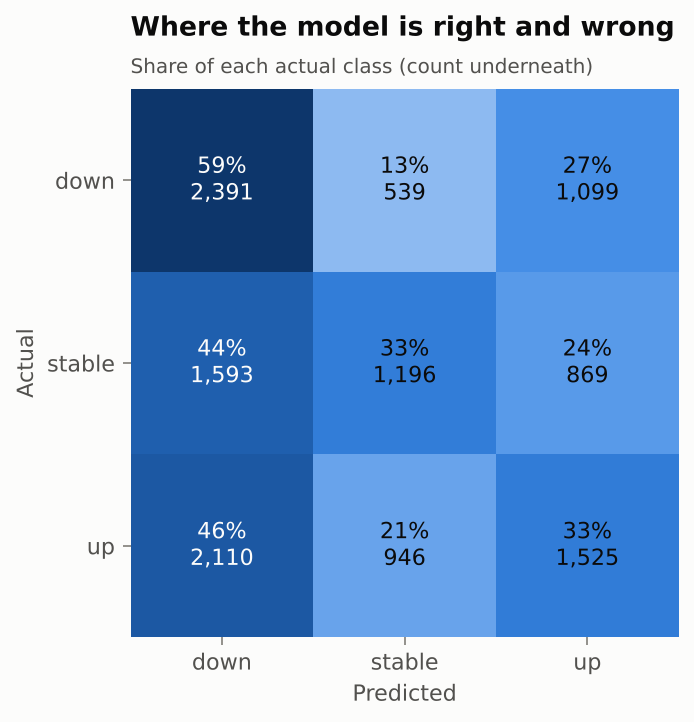
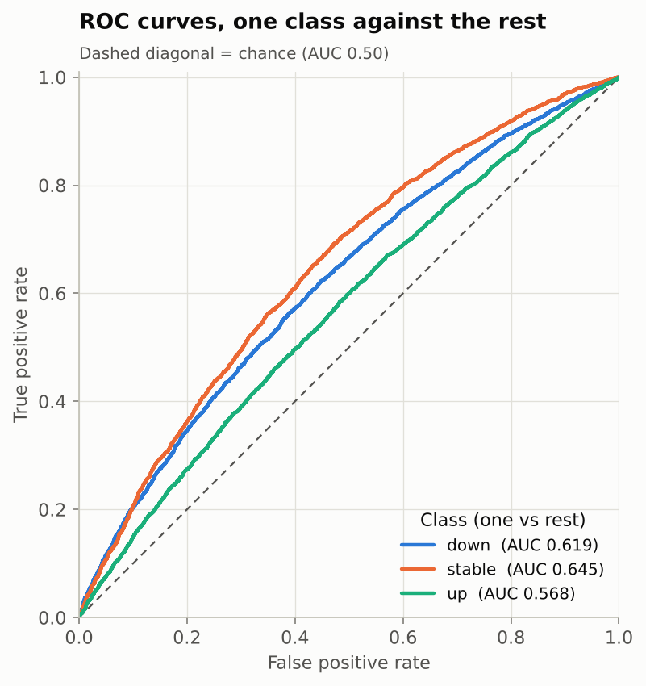

# CrimeBase: forecasting the direction of India's registered crime

A machine-learning mini-project on the Kaggle dataset
[`chandranshbinjola/crimebase`](https://www.kaggle.com/datasets/chandranshbinjola/crimebase): cleaning,
a classification task, XGBoost against stronger-looking alternatives, and an honest write-up of what the
data can and cannot support.

## What the data is, and the task

The download is **NCRB's published crime statistics** (state/UT × year × crime head × metric, 2001-2022), not a
table of individual crimes. Category labels in it are keyword rules, so classifying them would only relearn
the rules. The task that is not circular:

> For a state/UT and crime head in year *t*, will registered cases in year *t+1* go **down**, stay **stable**
> or go **up** (a ±10% band)?

Evaluation is strictly time-ordered: train on feature years up to 2016, tune on 2017-18, score **once** on
2019 onwards (12,268 rows). Full reasoning is in [`docs/design.md`](docs/design.md).

## Result

**Test set: feature years 2019 onwards, 12,268 rows, scored once.** Precision and recall are macro averages
over the three classes; ROC-AUC is one-vs-rest.

| Model | Accuracy | Precision | Recall | F1 (macro) [95% CI] | ROC-AUC |
|---|---|---|---|---|---|
| Always the commonest class | 0.298 | 0.099 | 0.333 | 0.153 [0.145, 0.162] | 0.500 |
| One-line mean-reversion rule | 0.394 | 0.412 | 0.403 | 0.387 [0.371, 0.404] | n/a |
| **XGBoost (tuned)** | **0.417** | **0.425** | **0.418** | **0.409** [0.391, 0.427] | **0.611** |

**Classification report, tuned XGBoost:**

| Class | Precision | Recall | F1-score | Support |
|---|---|---|---|---|
| down | 0.392 | 0.593 | 0.472 | 4,029 |
| stable | 0.446 | 0.327 | 0.377 | 3,658 |
| up | 0.437 | 0.333 | 0.378 | 4,581 |
| macro avg | 0.425 | 0.418 | 0.409 | 12,268 |

**Overfitting check** (one model fitted on the training years): macro-F1 is 0.487 on train, 0.413 on
validation and 0.390 on test.

| Confusion matrix | ROC curves (one class against the rest) |
|---|---|
|  |  |

* XGBoost beats the rule by **+0.022** macro-F1 (paired 95% CI +0.003 to +0.042). A real edge, but a modest one:
  AUC is about 0.61, where 0.50 is chance.
* **XGBoost is enough.** LightGBM, CatBoost, logistic regression and an ensemble were tried on the same split;
  none beats it by a margin that survives a paired test. Tuning improved cross-validation slightly but moved
  the held-out score by -0.008. The limit is the data, not the algorithm.
* What the model uses is mostly *what kind of series* it is (level, crime category, state, volatility), not
  last year's growth.

Every table and figure, numbered and captioned, is in [`reports/results.md`](reports/results.md), generated from
the saved metrics.

## Run it

Needs [uv](https://docs.astral.sh/uv/); Python 3.12 is pinned.

```bash
uv sync                                  # creates .venv from the lockfile
uv run python -m crimebase clean         # raw zip -> data/interim/panel.parquet            (~10 s)
uv run python -m crimebase features      # panel -> data/processed/model_matrix.parquet     (~4 s)
uv run python -m crimebase train         # tune + compare all models -> reports/metrics/   (~40 min, 4 CPUs)
uv run python -m crimebase sensitivity   # effect of the minimum-count rule                 (~1 min)
uv run python -m crimebase report        # reports/results.md, figures, models/             (~6 s)
uv run pytest                            # 155 tests, ~45 s
uv run jupyter lab                       # open notebooks/
```

The committed `reports/metrics/` already holds the full `train` run, so the notebooks and `report` work without
retraining; notebooks 03 and 04 only need `clean` and `features` first (the model matrix is rebuilt, not
committed). `train` overwrites the committed metrics; `git restore reports/` brings them back. For a quick
smoke run use `train --trials 5 --models xgboost lightgbm`.

## Notebooks

| | |
|---|---|
| [`01_data_understanding`](notebooks/01_data_understanding.ipynb) | what is in the zip, whether it checks out, why most targets are unusable, the NCRB-versus-news comparison |
| [`02_cleaning_and_comparison`](notebooks/02_cleaning_and_comparison.ipynb) | raw against clean, each cleaning rule with its evidence, label balance, a live leakage check |
| [`03_xgboost_classification`](notebooks/03_xgboost_classification.ipynb) | XGBoost: early stopping, tuning, held-out result, where it errs, SHAP |
| [`04_model_comparison`](notebooks/04_model_comparison.ipynb) | all models with paired tests, tuning, agreement, sensitivity, conclusion |

## Layout

```
configs/crimebase.yaml   every path, threshold, split year and seed
data/raw/                the dataset as downloaded (zip, read in place, never modified)
data/interim/            cleaned panel            (rebuilt, git-ignored)
data/processed/          model matrix with labels (rebuilt, git-ignored)
src/crimebase/           the package: data, clean, features, splits, models, tuning, evaluate,
                         experiment, results, explain, viz, report, pipeline, cli
notebooks/               the four notebooks above, executed
reports/                 metrics/ (CSV, JSON, predictions), figures/, results.md
models/                  the tuned XGBoost (written by the report stage, git-ignored)
tests/                   unit and end-to-end tests on a small synthetic panel
docs/design.md           design: contracts, cleaning rules, evaluation protocol, trade-offs
```

## Caveats

Reported crime is not crime: counts depend on registration practice and change definition between NCRB
editions, and they are not per capita because the zip holds no population table. Three held-out years is a
small number of independent periods, which is why intervals resample whole state-year groups. The model also
over-predicts "down" on those years (about half of rows against a third that really fell).
