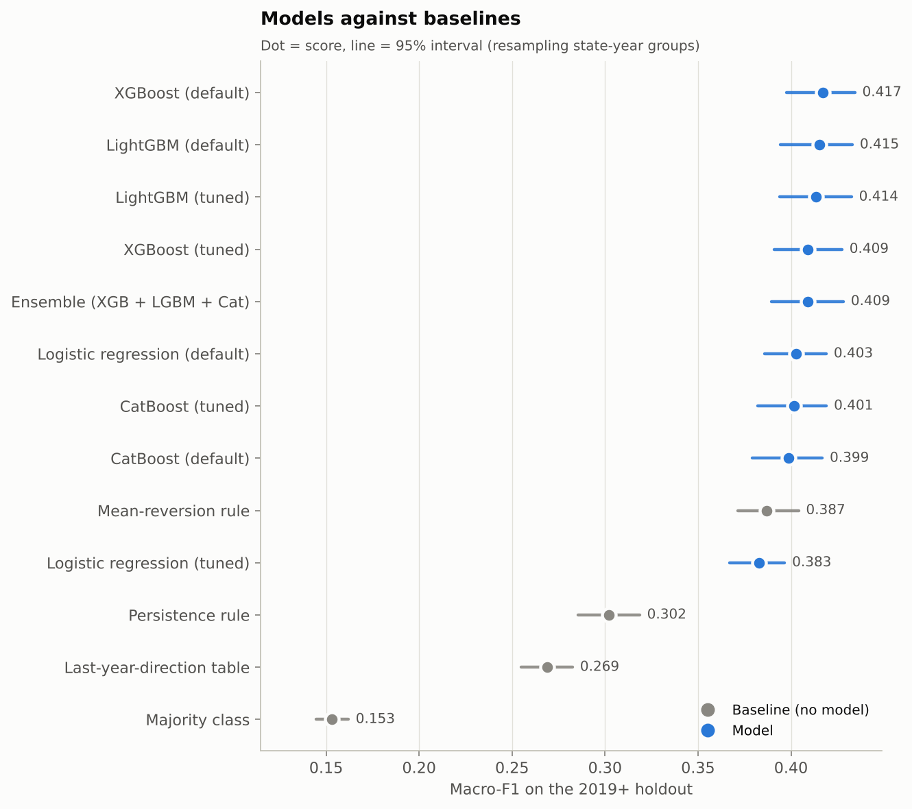
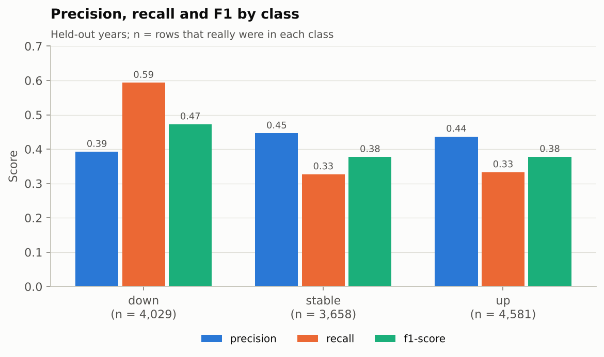
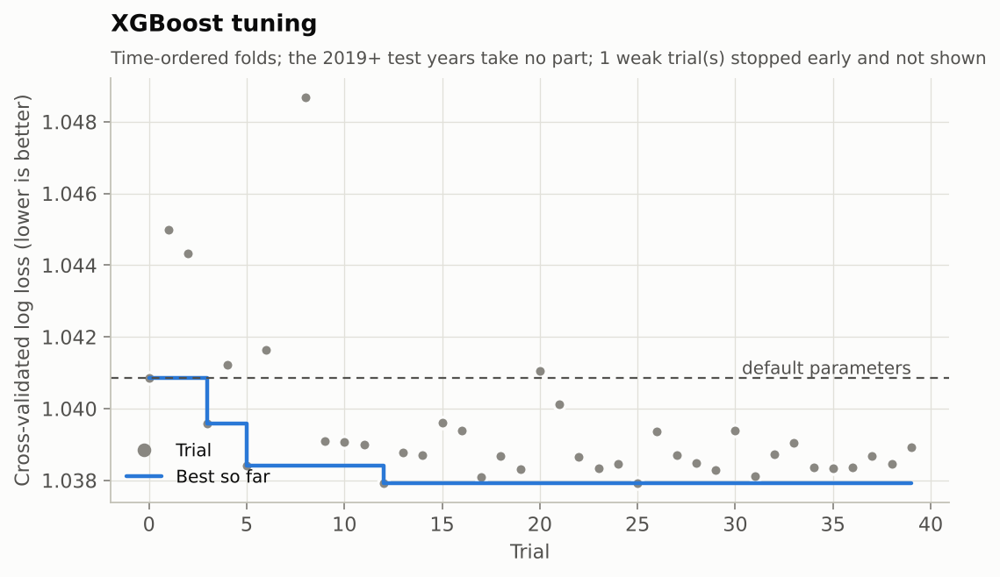
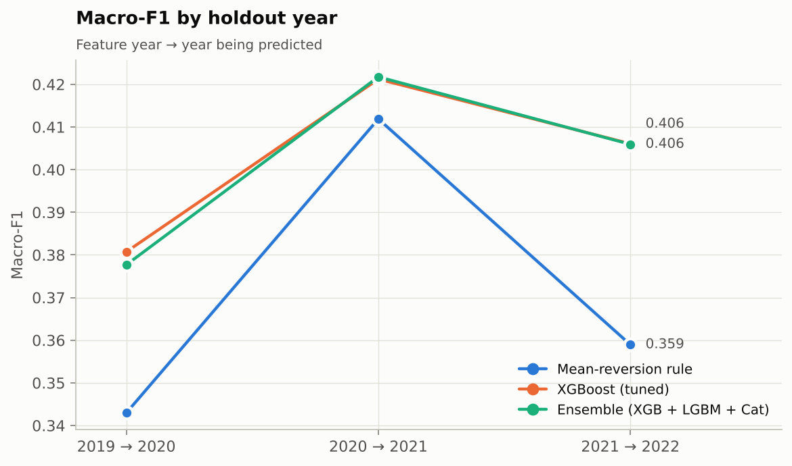
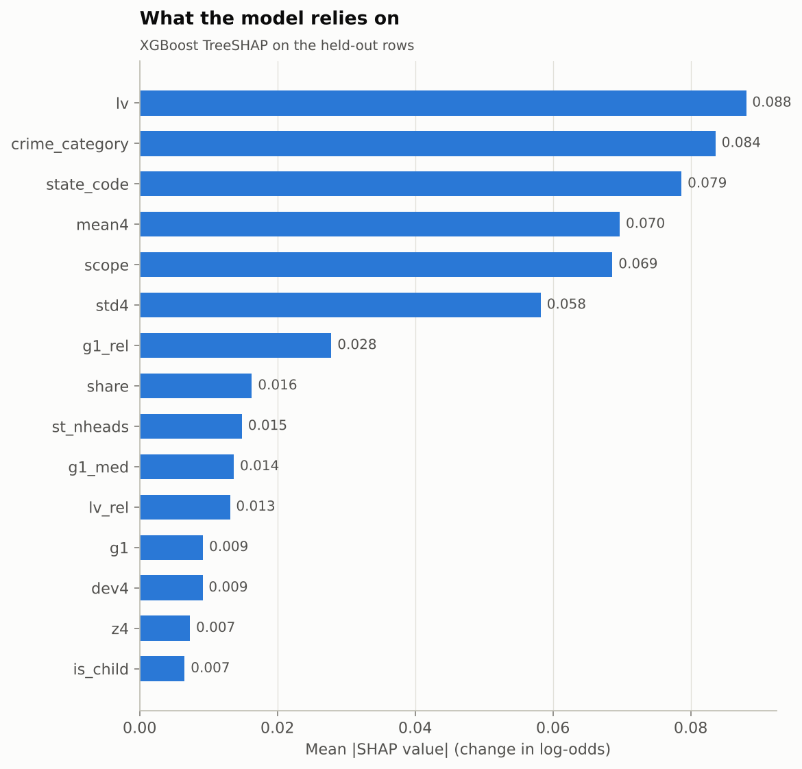
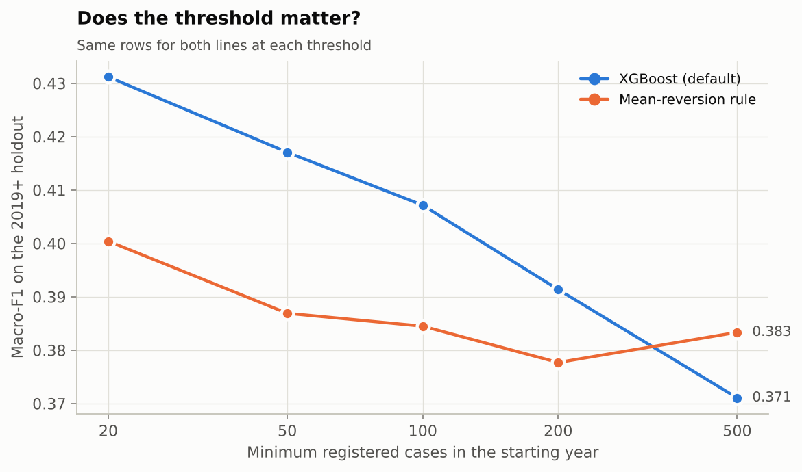

# Results: year-ahead crime trend by state and crime head

Generated by `python -m crimebase report` from `reports/metrics/`. Do not edit by hand.

## 1. Summary

The model fixed in advance, **tuned XGBoost**, scores **0.409** macro-F1 on the held-out years (95% CI 0.391 to 0.427). The one-line mean-reversion rule scores 0.387 and always predicting the commonest training class scores 0.153. XGBoost beats that rule by +0.022 macro-F1 (paired 95% CI +0.003 to +0.042), an interval that excludes zero. All 9 model variants land between 0.383 and 0.417; naming the top one on the test set would be optimistic, so no winner is picked from it. Tuning moved held-out macro-F1 by -0.008 (paired CI -0.015 to -0.0004, which excludes zero).

## 2. Problem and data

- **Task:** multi-class classification. For a state/UT and crime head in year *t*, predict whether `cases_registered` in *t+1* goes **down**, stays **stable** or goes **up**, with a band of ±10%.
- **Rows:** a series-year needs at least 50 registered cases, a next year, no state boundary change, no source switch and no 10x jump.
- **Split (by time, never random):** train on feature years up to 2016, validate on 2017-2018, test once on 2019 onwards (**12,268 test rows** in 107 state-year groups).
- **Classes:** `down`, `stable`, `up`; chance accuracy is about one in three.
- **Tuning:** 40 Optuna trials per model over expanding time folds; confidence intervals are 500-resample bootstraps of whole state-year groups.

## 3. Test-set performance of every model

**Table 1.** Metrics on the held-out years. Precision and recall are macro averages over the three classes; ROC-AUC is one-vs-rest. Lower log loss is better.

| Model | Accuracy | Precision (macro) | Recall (macro) | F1 (macro) [95% CI] | ROC-AUC [95% CI] | Log loss | Trees |
|---|---|---|---|---|---|---|---|
| Majority class | 0.298 | 0.099 | 0.333 | 0.153 [0.145, 0.162] | 0.500 [0.500, 0.500] | 1.107 |  |
| Persistence rule | 0.316 | 0.304 | 0.318 | 0.302 [0.285, 0.319] | n/a | n/a |  |
| Mean-reversion rule | 0.394 | 0.412 | 0.403 | 0.387 [0.371, 0.404] | n/a | n/a |  |
| Last-year-direction table | 0.378 | 0.252 | 0.353 | 0.269 [0.255, 0.283] | 0.560 [0.549, 0.572] | 1.095 |  |
| XGBoost (default) | 0.424 | 0.434 | 0.426 | 0.417 [0.398, 0.434] | 0.609 [0.585, 0.630] | 1.069 | 115 |
| XGBoost (tuned) | 0.417 | 0.425 | 0.418 | 0.409 [0.391, 0.427] | 0.611 [0.589, 0.631] | 1.065 | 181 |
| LightGBM (default) | 0.424 | 0.433 | 0.424 | 0.415 [0.394, 0.433] | 0.607 [0.583, 0.627] | 1.072 | 93 |
| LightGBM (tuned) | 0.423 | 0.434 | 0.423 | 0.414 [0.394, 0.433] | 0.614 [0.591, 0.634] | 1.069 | 127 |
| CatBoost (default) | 0.412 | 0.421 | 0.413 | 0.399 [0.379, 0.417] | 0.607 [0.587, 0.625] | 1.067 | 62 |
| CatBoost (tuned) | 0.415 | 0.423 | 0.416 | 0.401 [0.382, 0.419] | 0.611 [0.590, 0.628] | 1.066 | 78 |
| Logistic regression (default) | 0.414 | 0.426 | 0.417 | 0.403 [0.386, 0.419] | 0.610 [0.590, 0.627] | 1.101 |  |
| Logistic regression (tuned) | 0.406 | 0.420 | 0.408 | 0.383 [0.367, 0.397] | 0.602 [0.586, 0.619] | 1.092 |  |
| Ensemble (XGB + LGBM + Cat) | 0.419 | 0.429 | 0.420 | 0.409 [0.389, 0.428] | 0.613 [0.592, 0.633] | 1.065 |  |



**Figure 1.** Macro-F1 of every model with 95% intervals; baselines are grey.

## 4. The final model: tuned XGBoost

### 4.1 Classification report

**Table 2.** Per-class precision, recall and F1 on the held-out years.

| Class | Precision | Recall | F1-score | Support |
|---|---|---|---|---|
| down | 0.392 | 0.593 | 0.472 | 4,029 |
| stable | 0.446 | 0.327 | 0.377 | 3,658 |
| up | 0.437 | 0.333 | 0.378 | 4,581 |
| accuracy |  |  | 0.417 | 12,268 |
| macro avg | 0.425 | 0.418 | 0.409 | 12,268 |
| weighted avg | 0.425 | 0.417 | 0.409 | 12,268 |



**Figure 2.** Precision, recall and F1 by class.

### 4.2 Confusion matrix


**Figure 3.** Row-normalised confusion matrix: the share of each actual class, with the count underneath.

Actual mix of the held-out rows: down 33%, stable 30%, up 37%. Mix the model predicted: down 50%, stable 22%, up 28%.

### 4.3 ROC curves


**Figure 4.** One-vs-rest ROC curve per class; the dashed line is chance.

### 4.4 Train, validation and test

**Table 3.** One XGBoost model fitted on the training years and early-stopped on the validation years, scored on all three splits. The headline test numbers above refit on train + validation first, so they differ from this table's test row.

| Split | Years (feature year) | Rows | Accuracy | Precision (macro) | Recall (macro) | F1 (macro) | ROC-AUC | Log loss |
|---|---|---|---|---|---|---|---|---|
| Train | 2001-2016 | 24,114 | 0.492 | 0.496 | 0.497 | 0.487 | 0.685 | 1.008 |
| Validation | 2017-2018 | 4,012 | 0.418 | 0.436 | 0.434 | 0.413 | 0.628 | 1.054 |
| Test | 2019-2021 | 12,268 | 0.408 | 0.419 | 0.412 | 0.390 | 0.604 | 1.074 |

Macro-F1 is 0.487 on the training years, 0.413 on validation and 0.390 on test: a train-to-test gap of 0.097. The model fits the rows it was trained on better than unseen years, so the held-out numbers, not the training ones, are the result.

## 5. Is one model really better? Paired tests

**Table 4.** Difference between two models on the same bootstrap resamples, so shared noise cancels. `Excludes 0` says whether the 95% interval stays on one side of zero.

| A | B | Metric | A - B [95% CI] | Excludes 0 |
|---|---|---|---|---|
| XGBoost (tuned) | Mean-reversion rule | macro-F1 | 0.022 [0.003, 0.042] | yes |
| XGBoost (tuned) | XGBoost (default) | macro-F1 | -0.008 [-0.015, -0.0004] | yes |
| XGBoost (tuned) | XGBoost (default) | ROC-AUC | 0.002 [-0.003, 0.007] | no |
| XGBoost (tuned) | Logistic regression (tuned) | macro-F1 | 0.026 [0.013, 0.040] | yes |
| XGBoost (tuned) | Logistic regression (tuned) | ROC-AUC | 0.009 [-0.002, 0.020] | no |
| LightGBM (tuned) | XGBoost (tuned) | macro-F1 | 0.004 [-0.001, 0.010] | no |
| LightGBM (tuned) | XGBoost (tuned) | ROC-AUC | 0.003 [-0.0004, 0.005] | no |
| CatBoost (tuned) | XGBoost (tuned) | macro-F1 | -0.008 [-0.016, -0.0003] | yes |
| CatBoost (tuned) | XGBoost (tuned) | ROC-AUC | -0.0005 [-0.006, 0.004] | no |
| Ensemble (XGB + LGBM + Cat) | XGBoost (tuned) | macro-F1 | -0.0001 [-0.004, 0.004] | no |
| Ensemble (XGB + LGBM + Cat) | XGBoost (tuned) | ROC-AUC | 0.002 [0.0002, 0.004] | yes |

## 6. Hyperparameter tuning

**Table 5.** Mean cross-validated log loss over the time folds (lower is better).

| Model | Trials | Default CV log loss | Tuned CV log loss | Gain |
|---|---|---|---|---|
| XGBoost | 40 | 1.0408 | 1.0379 | 0.0029 |
| LightGBM | 40 | 1.0434 | 1.0376 | 0.0057 |
| CatBoost | 40 | 1.0419 | 1.0413 | 0.0007 |
| Logistic regression | 12 | 1.0689 | 1.0521 | 0.0168 |



**Figure 5.** Each completed trial and the best so far.

## 7. Performance by held-out year

**Table 6.** Macro-F1 for each feature year in the test period.

| Year | Mean-reversion rule | XGBoost (tuned) | Ensemble (XGB + LGBM + Cat) |
|---|---|---|---|
| 2019 to 2020 | 0.343 | 0.381 | 0.378 |
| 2020 to 2021 | 0.412 | 0.421 | 0.422 |
| 2021 to 2022 | 0.359 | 0.406 | 0.406 |



**Figure 6.** Macro-F1 by held-out year.

## 8. What drives the model (TreeSHAP)

The three features the model leans on most are `lv`, `crime_category` and `state_code`. Last year's own growth (`g1`) ranks 12 of 29.

**Table 7.** The ten features with the largest mean absolute SHAP value over the test rows.

| Feature | Mean abs. SHAP |
|---|---|
| lv | 0.088 |
| crime_category | 0.084 |
| state_code | 0.079 |
| mean4 | 0.070 |
| scope | 0.069 |
| std4 | 0.058 |
| g1_rel | 0.028 |
| share | 0.016 |
| st_nheads | 0.015 |
| g1_med | 0.014 |

`lv` is the log of this year's count, `mean4` and `std4` the mean and spread of the last four years of log counts, `g1` last year's log growth and `g1_rel` that growth relative to other states for the same head.



**Figure 7.** Mean absolute SHAP value of the top features.

## 9. Sensitivity to the minimum-count rule

At the thresholds tried, the model's edge over the rule is clearly positive at min_cases = [20, 50] and its interval includes zero at [100, 200, 500].

**Table 8.** Default XGBoost and the mean-reversion rule scored on the same rows at each minimum count.

| min_cases | Labelled test rows | XGBoost macro-F1 | Rule macro-F1 | Edge [95% CI] |
|---|---|---|---|---|
| 20 | 16,176 | 0.431 | 0.400 | 0.031 [0.011, 0.047] |
| 50 | 12,268 | 0.417 | 0.387 | 0.030 [0.009, 0.051] |
| 100 | 9,733 | 0.407 | 0.384 | 0.023 [-0.003, 0.047] |
| 200 | 7,602 | 0.391 | 0.378 | 0.014 [-0.017, 0.045] |
| 500 | 5,404 | 0.371 | 0.383 | -0.012 [-0.044, 0.023] |



**Figure 8.** Macro-F1 of the model and of the rule as the minimum count rises.

## 10. Limitations

- Reported crime reflects registration practice, not crime itself; definitions change between NCRB editions and a row that jumps 10x is treated as a definition break.
- Counts are raw, not per capita: the zip has no state population table.
- Three held-out years (one of them 2020) is a small number of independent periods, which is why the intervals resample whole state-year groups.
- The signal is modest. Compare every model with the mean-reversion rule, not chance.

## Reproduce

```bash
uv sync
uv run python -m crimebase clean && uv run python -m crimebase features
uv run python -m crimebase train          # about 40 minutes on 4 CPUs
uv run python -m crimebase sensitivity && uv run python -m crimebase report
```
